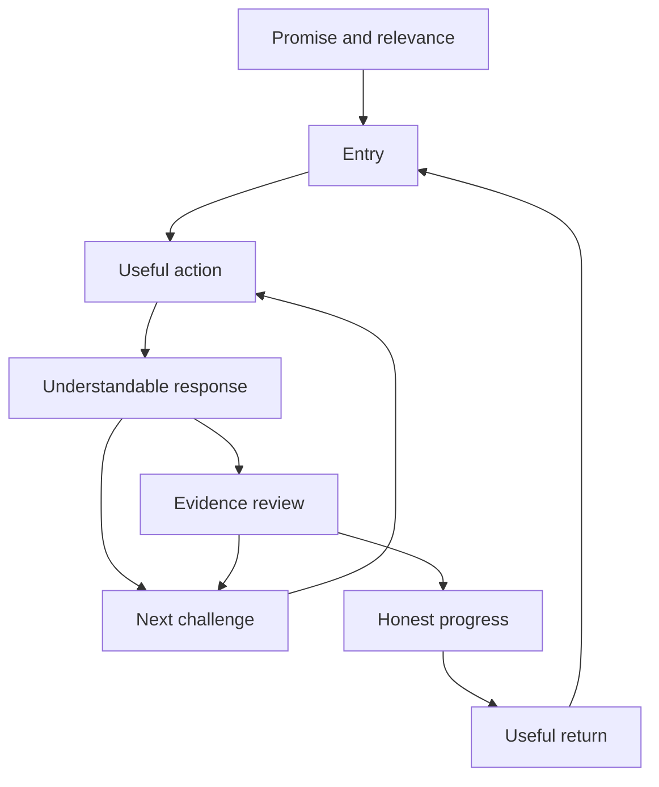
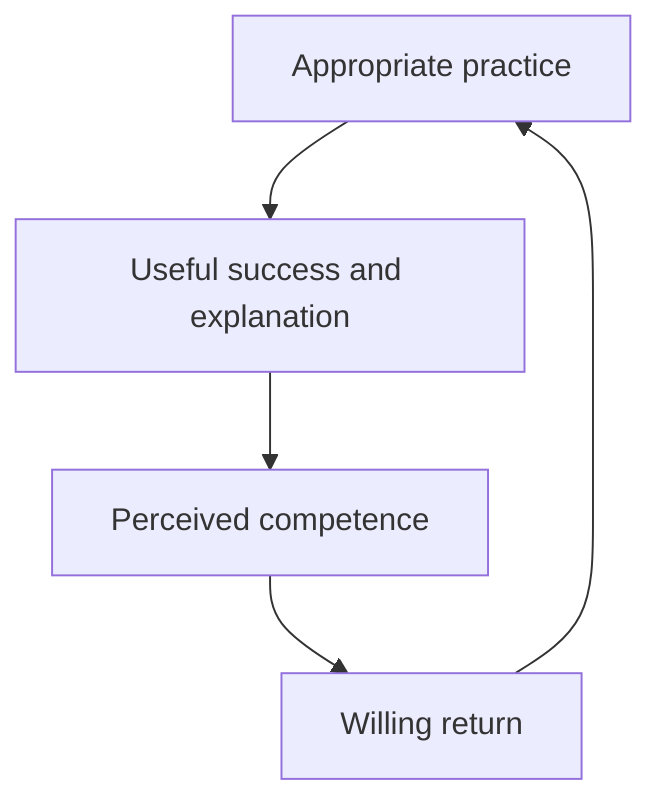

# The Play and Learning System

## A systems framework for useful repeat practice

Prepared for Levi Zigza and Purpose Academy. Version 1.0. 26 October 2026.

This document proposes a new implementation framework synthesized from the companion comparative report. It reorganizes the useful parts of casual games into a system for adult learning. It is not an established psychological theory, a proprietary company method, or a validated prediction of commercial success.

## 1 The system in one paragraph

Give a person a worthwhile reason to begin. Make one useful action easy to understand and perform. Show a consequence they can interpret. Adjust the next challenge using valid evidence. Preserve meaningful progress. Offer a useful reason to return, and let them stop. Keep the content, technology, accessibility, and human review reliable enough that each cycle deserves trust. The system works when repeat participation produces retained and usable learning, not only more activity.

## 2 The eight components

| Component | Plain-language question | Output | Typical failure |
|---|---|---|---|
| Promise | Why is this useful to me? | A relevant expectation | The advertised benefit and actual activity differ |
| Entry | Can I begin without unnecessary effort? | A first meaningful action | Setup, load time, or instructions block participation |
| Action | What do I do now? | A response to a coherent task | Controls and learning demands are mixed or unclear |
| Response | What happened and what does it mean? | Understandable feedback | An effect or score replaces explanation |
| Challenge | What should I try next? | Appropriate difficulty and support | The task is trivial, inaccessible, or opaque |
| Progress | What have I accomplished? | An honest persistent record | Points are mistaken for competence |
| Return | Why and when is another session useful? | A voluntary next opportunity | Pressure, backlog, or empty reminders drive return |
| Evidence | What can we responsibly conclude? | A scoped learning judgment | Activity is interpreted as retained skill |

These components are roles, not necessarily eight screens or services. A short learning activity can contain several. Keep their responsibilities explicit even when the implementation is compact.

### The interaction diagram



The feedback path to Challenge matters: the next task should respond to what the evidence shows. The route from Progress to Return matters: a later session should build on something preserved. Evidence may require time and human observation, so it does not always arrive immediately.

## 3 The boundary of the system

The app can provide reviewed instruction, practice, reminders, feedback, and records. It cannot alone establish every real-world skill, guarantee employment, remove all language barriers, or replace an instructor's practical judgment.

The surrounding system includes learners' schedules, devices, internet access, literacy, prior experience, instructors, curriculum reviewers, classroom activity, partner organizations, and the funding model. Those conditions influence participation and outcomes. Treating the app screen as the whole system hides important causes of failure.

For Purpose Academy, the initial boundary is one reviewed construction learning module connected to a defined instructor workflow. Logistics and Community Support are later, separately reviewed streams. The framework is adaptable, but the initial implementation should remain small. [PA1, PA2]

## 4 What each component borrows from casual games

| Component | Useful old parts | What changes for learning |
|---|---|---|
| Promise | A visible puzzle, understandable challenge, or familiar premise | State the useful language or task benefit honestly |
| Entry | Few controls, quick start, contextual teaching | Accommodate literacy and device needs without shaming |
| Action | A stable grammar such as swap, aim, tap, connect, or choose | Make the target skill necessary to succeed |
| Response | Clearing, filling, merging, movement, or a visible result | Explain the relevant distinction and preserve access without effects |
| Challenge | New combinations, constraints, and optional stretch goals | Adjust support and task form without moving the academic standard |
| Progress | A map, record, restored world, or collection | Distinguish practice, retained evidence, and observed competence |
| Return | A new puzzle, another person's turn, or a continuing project | Use due review, relevant tasks, and optional cooperation |
| Evidence | State tracking and performance instrumentation | Add content validity, delayed checks, transfer, and assessor authority |

The commercial games do not all contain every old part. The framework combines selected functions rather than claiming a universal feature inventory. The companion report provides the 36-case comparison and counterexamples.

## 5 Four different kinds of state

### 5.1 Activity state

The current prompt, chosen answer, remaining steps, animation state, and session status. This state can change many times in a minute. It tells the engine what to present next.

### 5.2 Practice history

What the learner saw and attempted, including content version, modality, support, timing, and result. This is a factual event history. Corrections should be recorded rather than silently rewriting it.

### 5.3 Learning evidence

The conclusions the approved policy permits from that history. A supported match, independent delayed recall, contextual response, and practical observation are different evidence types. Some conclusions require a later date or a qualified assessor.

### 5.4 Presentation progress

The map, optional visual project, session acknowledgment, or private consistency display. This helps people interpret progress. It may reflect evidence or activity, but it must say which. A decorative object does not become a credential.

### The authority rule

```text
presentation may read activity and evidence
activity may create attempts
evidence policy may evaluate eligible attempts
authorized assessors may create practical observations
presentation and cosmetic rewards may not manufacture evidence
```

This rule is more important than a particular game theme. It prevents a seemingly harmless reward feature from becoming an invalid academic decision.

## 6 Stocks, flows, and delays

Systems thinking separates what accumulates from what happens at a moment. Some stocks below are conceptual rather than directly measurable quantities.

| Stock | Inflow | Outflow or limitation | Observable indicator |
|---|---|---|---|
| Usable retained knowledge | Effective learning and retrieval | Forgetting or context-specific failure | Eligible delayed checks and transfer tasks |
| Verified evidence record | Valid attempts and assessor observations | Evidence can become outdated for a current claim; history remains | Versioned records with date and scope |
| Approved content library | Reviewed items and assets | Withdrawal, revision, or newly found ambiguity | Published valid item forms per objective |
| Learner trust | Accurate feedback, reliability, and fair treatment | Misleading judgments, errors, pressure, or lost work | Reports, interviews, and return behavior interpreted cautiously |
| Outstanding review work | New due items | Completed or intentionally reprioritized review | A bounded, dimension-specific due queue |
| Staff capacity | Available teaching and review time | Support load, content defects, and administration | Turnaround time and work per reviewed item |

Do not treat trust or knowledge as numbers that can be read directly from clicks. A stage label is an operational approximation. Validate how well it predicts the actual outcome.

### Delays that change the system

- Feedback can be immediate, but durable retention cannot be established at the moment of first success.
- A translation or scenario correction requires review before republication.
- An instructor may observe practical application after several app sessions.
- A distribution campaign can change who enters before learning outcomes arrive.
- Repeated reminders may increase opens immediately while trust deteriorates more slowly.

These delays can make a short-term dashboard favor a harmful change. Evaluate the outcomes over the time they require.

## 7 The important feedback loops

### R1 Competence and useful practice



This is a proposed reinforcing loop supported by the role of competence in game motivation and the instructional role of practice. It is not automatic. The loop breaks if “success” is trivial, feedback is misleading, or practice fails to support retention. [R01, R06]

### R2 Evidence and relevance

Valid evidence helps the instructor and scheduler identify an appropriate next task. An appropriate task makes the activity more useful. Useful activity generates better interpretable evidence. This loop depends on item validity and a sensible evidence policy. More data from invalid items reinforces the wrong model.

### R3 Reliability and trust

Accurate content and preserved work support trust. Trust can make people more willing to report problems and try again. Problem reports can improve content and reliability. The reinforcing link requires a real response to reports; collecting complaints without correcting defects does not close the loop.

### B1 Fatigue and stopping

More activity can increase fatigue or displace other responsibilities. Fatigue can reduce attention and the quality of later practice. A finite session and an easy stopping point limit this effect. This balancing loop is healthy. Treating every stop as a product failure creates an incentive to override it.

### B2 Challenge and support

Repeated difficulty should increase useful support or simplify an instructional component. Better understanding should permit a more independent task later. The controller should respond to valid evidence, not punish someone for a broken audio file or a slower input method.

### B3 Backlog and return avoidance

Newly due reviews can grow faster than available practice time. A large overdue queue can make returning feel costly, which can reduce practice and enlarge the queue further. This is a harmful reinforcing pattern inside a scheduling system. Bound the visible queue, prioritize high-value objectives, and offer a manageable restart.

### B4 Content demand and review capacity

More content and activity styles create more review and maintenance work. If publication outpaces qualified review, defects grow and evidence becomes less trustworthy. Limit expansion to review capacity. A small reliable library can be more useful than a large unverified one.

## 8 The three control loops

### 8.1 The moment loop

**Timescale:** one interaction.

**Observe:** the response and any delivery failure. **Decide:** the published evaluation rule. **Act:** show specific feedback and the next supported option.

Do not allow a decorative animation to alter correctness or duplicate a submission. A failed asset load should trigger recovery. Keep semantic feedback available without audio, color, or motion effects.

### 8.2 The learning loop

**Timescale:** hours, days, and weeks.

**Observe:** dimension-specific attempts under known conditions. **Decide:** whether more teaching, independent retrieval, delayed review, transfer, or human observation is needed. **Act:** recommend a small appropriate session.

Do not infer retained learning from a revealed-answer retry. Do not erase historical achievement because a review is due. Do not equate assisted practice with failure: it has a different purpose.

### 8.3 The product loop

**Timescale:** release and evaluation cycles.

**Observe:** usability, learning, experience, reliability, and operating cost. **Decide:** which component is the current bottleneck. **Act:** change a defined feature, content set, or support process and evaluate it again.

Do not optimize only the easiest metric to improve. A higher app-open rate with lower delayed recall is not a successful learning intervention. Small pilot differences should guide investigation rather than create exaggerated certainty.

## 9 The system equations

These are definitions and design abstractions. They are not validated equations of human behavior.

### 9.1 State and evidence remain separate

```text
activity_next = rules(activity_now, action, item_version)
attempt = record(action, evaluation, support, delivery_conditions)
evidence_next = policy(evidence_now, attempt)
next_task = scheduler(evidence_next, curriculum, learner_goal, time)
```

### 9.2 Useful reach has sequential bottlenecks

```text
people completing a defined transfer pathway
= unique exposure
  * probability of trial given exposure
  * probability of activation given trial
  * probability of useful return given activation
  * probability of retained learning given that return pathway
  * probability of transfer given retained learning on that pathway
```

The conditional denominators must be nested. This is one pathway identity, not a whole-population causal model. A different entry route or prior knowledge may require another pathway.

### 9.3 Learning efficiency needs valid units

```text
observed learning efficiency
= retained objectives meeting the stated criterion
  / active practice time under the stated conditions
```

Report the numerator, denominator, and missing outcomes. Compare comparable objectives. Do not encourage rushing by making this a public learner ranking. Time spent may include useful explanation that pays off later.

### 9.4 Capacity constrains publication

```text
safe publication rate cannot exceed
the rate at which required content and asset review is completed
```

This is an operating constraint. Automated checks can reduce review effort, but valid JSON is not a substitute for language and domain judgment.

## 10 A concrete vertical slice

### The objective

“The learner can understand a short request involving a familiar measuring tool and give an appropriate clarification or confirmation response.” This illustrative objective requires curriculum review before learner release.

### The slice

1. An instructor assigns the objective within the construction module.
2. The learner opens a short relevant practice activity.
3. A reviewed object image, English meaning, and audio introduce the concept.
4. A recognition task teaches the interface and checks supported understanding.
5. A later item uses listening with a different approved example.
6. A phrase task practices asking for clarification.
7. The session ends with an honest summary and saves progress.
8. A later independent check tests the intended dimension before showing a hint.
9. A new reviewed scenario tests transfer beyond the original screen.
10. If physical use is in the curriculum, an authorized instructor observes it separately.

### How the eight components appear

| Component | Implementation in the slice |
|---|---|
| Promise | “Practice understanding today's measurement requests” |
| Entry | Resume directly into a prepared activity |
| Action | Listen, identify, or choose an appropriate response |
| Response | Explain the relevant object, value, unit, or phrase |
| Challenge | Change one dimension while controlling others |
| Progress | Distinguish supported practice from later evidence |
| Return | Offer the next useful review when due |
| Evidence | Preserve conditions and require practical observation where needed |

### What counts and what does not

Recognition counts as recognition. A transcript-assisted listening item counts under its support policy. A corrected retry counts as supported practice. A delayed independent success can support a retained-evidence stage. A decorative route checkpoint counts as presentation progress. None of these alone creates a practical qualification.

## 11 The minimum architecture

Use the existing project's stack and conventions. The roles below can be modules in one application; microservices are not a requirement.

| Module | Core responsibility | Interface |
|---|---|---|
| Content registry | Resolve approved immutable item versions | `getPublishedItem(id, version)` |
| Activity engine | Run accessible interaction states | `present(item, taskForm)` |
| Attempt recorder | Store one durable attempt | `recordAttempt(payload, idempotencyKey)` |
| Evidence evaluator | Apply the explicit evidence policy | `evaluateEligibility(attempt, policyVersion)` |
| Review planner | Select a bounded useful session | `planSession(learner, budget, now)` |
| Progress view | Present records with accurate labels | `getProgressSummary(learner, scope)` |
| Instructor workflow | Assign, review, observe, and correct | Role-checked commands with audit records |
| Operations and analytics | Find defects and evaluate changes | Defined events and outcome queries |

The important properties are versioning, clear authority, durable records, access control, and recoverable failure. A complex architecture would be counterproductive if a small pilot can implement these roles clearly in its existing codebase.

## 12 The decision policy

| Observation | Appropriate response | Inappropriate shortcut |
|---|---|---|
| Wrong answer with valid delivery | Provide a specific explanation and another useful form | Remove practice access |
| Audio fails to load | Recover and record delivery failure | Mark listening comprehension wrong |
| Correct immediately after answer reveal | Record supported practice | Advance to retained independent mastery |
| Independent delayed success | Update the relevant dimension under the policy | Certify unrelated practical skills |
| Multiple plausible answers reported | Suspend or review the item version | Assume all complainants lack knowledge |
| Learner returns after a break | Offer a manageable relevant session | Erase progress or display punitive backlog |
| High app activity but low transfer | Inspect task validity and practice mix | Add more reminders |
| Large content queue awaiting review | Reduce scope or increase qualified capacity | Auto-publish generated material |
| Small-group metric difference | Investigate conditions and uncertainty | Publicly rank groups or claim a stable causal effect |

## 13 Failure modes and recovery paths

### Reward activity without learning

**Symptom:** repeated easy items, high points, weak delayed checks. **Likely system issue:** presentation rewards are coupled to raw activity. **Recovery:** reward meaningful completion lightly, keep retained evidence separate, diversify reviewed task forms, and examine the practice mix.

### Challenge the wrong capability

**Symptom:** a learner understands the instruction but repeatedly fails dragging or timing. **Issue:** motor execution is being treated as language knowledge. **Recovery:** offer equivalent controls and remove irrelevant timing demands. Record task form and accommodations without stigma.

### Let assistance contaminate measurement

**Symptom:** rapid success after a hint appears as independent mastery. **Issue:** the event model omits support or answer-reveal timing. **Recovery:** preserve the attempt history, correct the derived stage, and schedule an eligible later check.

### Lose trust through content errors

**Symptom:** an image, translation, or answer key contradicts a knowledgeable learner. **Issue:** publication outpaced review or version control. **Recovery:** withdraw the affected version, notify relevant staff, review affected judgments, and issue an auditable correction.

### Build a return loop from pressure

**Symptom:** more opens but reported guilt, rushed completion, or avoidance after a missed day. **Issue:** reminders and scarcity replaced useful return value. **Recovery:** reduce pressure, preserve progress, restore control, and evaluate useful learning rather than opens alone.

### Copy a mature game's operating burden

**Symptom:** many currencies, events, and screens but little reviewed content. **Issue:** the team copied the visible surface of a large service. **Recovery:** return to one activity, one objective chain, one review loop, and one clear progress display.

## 14 The operating dashboard

Use one view with four separate questions:

1. **Can learners use it?** Starting completion, delivery failures, recovery, accessibility issues.
2. **Are they doing worthwhile practice?** Relevant attempts by dimension, support patterns, voluntary completion.
3. **Does learning persist and transfer?** Eligible delayed checks, new scenarios, required assessor records.
4. **Can we sustain it?** Review turnaround, support effort, content defects, and cost.

Display raw counts and denominators beside rates. Keep whole-cohort outcomes alongside active-user results. Do not hide people who stopped participating. Avoid individual or small-group reporting that unnecessarily exposes personal learning difficulties.

## 15 A build sequence with release gates

### Gate one The activity is understandable

Build the core with reviewed content and plain presentation. Observe actual learners. Resolve control ambiguity and inaccessible interactions. A successful demonstration by the developer does not satisfy the gate.

### Gate two The evidence is valid

Verify answer keys, task form, support policy, version identity, delayed-check eligibility, and separation from practical observation. Invalid content blocks publication even when the interaction is enjoyable.

### Gate three Progress survives real use

Verify pausing, backgrounding, reloading, duplicate submission, offline recovery where supported, and item revision. A returned learner sees an accurate manageable next step.

### Gate four The game presentation helps

Compare the plain activity with a specific game presentation under reasonably comparable learning opportunity. Examine delayed outcomes, burden, and experience. Keep a simpler accessible path.

### Gate five The operation can support expansion

Add more reviewed objectives and only then optional social features or new streams. Confirm that instructor support and content review can keep up. Evaluate operating costs as well as engagement.

## 16 What to give Cursor

Provide this framework, the companion research report, the implementation brief, the comparison table, and the schema and draft examples. Ask Cursor to inspect the actual repository and map existing code to the eight components before proposing a change set.

Require a narrow vertical slice, explicit unknowns, reversible changes, meaningful checks, and evidence labels that match their meaning. Do not ask it to implement every pattern from every game. The system is defined by coherent responsibilities and learning outcomes, not by the number of gamification features present.

## 17 The framework in an implementation checklist

- One relevant promise for the chosen learner and task.
- One accessible route to a useful action.
- A stable interaction grammar.
- Specific understandable feedback.
- A challenge policy that distinguishes knowledge from delivery and access problems.
- Separate activity, history, evidence, and presentation states.
- A bounded return path with preserved progress.
- Reviewed content with immutable versions.
- Explicit delayed and transfer checks.
- Human authority for required practical observation.
- A dashboard that separates engagement, learning, experience, and cost.
- A release process that removes components that do not earn their place.

## 18 Evidence and provenance

The framework's structure and engineering policies are new proposals. Its foundations include the game comparison, research on motivation, retrieval, spacing, gamification, feedback, and the supplied Purpose Academy curriculum documents. Consult the companion report for full sources, qualifications, historical cases, and alternative explanations.

- [R01] Ryan, Rigby, and Przybylski. The Motivational Pull of Video Games. https://www.rochester.edu/warner/lida/wp-content/uploads/2022/11/02bfe513dd59366750000000.pdf
- [R03] Sailer and Homner. The Gamification of Learning. https://link.springer.com/article/10.1007/s10648-019-09498-w
- [R05] Habgood and Ainsworth. Intrinsic Integration in Educational Games. https://doi.org/10.1080/10508406.2010.508029
- [R06] Karpicke and Roediger. The Critical Importance of Retrieval for Learning. https://pubmed.ncbi.nlm.nih.gov/18276894/
- [R07] Cepeda and colleagues. Distributed Practice in Verbal Recall Tasks. https://www.yorku.ca/ncepeda/publications/CPVWR2006.html
- [PA1] Purpose Academy Business Plan. https://chatgpt.com/library?file_id=libfile_0eeedede00ac8191a7169e7e60f40b2b&account_id=personal
- [PA2] Purpose Academy Occupational Language and Vocabulary Framework. https://chatgpt.com/library?file_id=libfile_b7c3f5804d508191a5c611ba97ec4b2f&account_id=personal

The central system requirement is simple: **make useful practice compelling, and keep every claim about learning accountable to evidence.**
